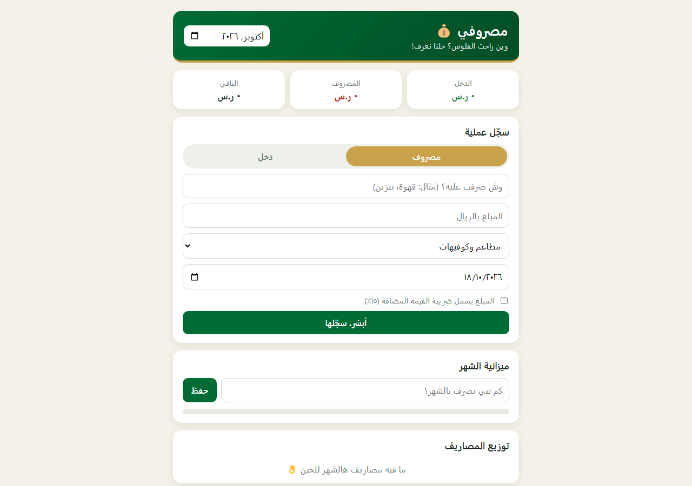

# مصروفي 💰

متتبع مصاريف ودخل بالريال السعودي، يجاوبك على سؤال "وين راحت الفلوس؟" بدون ما تحتاج إكسل ولا تطبيق خارجي. مبني بالكامل بـ HTML + CSS + JavaScript خالص، بدون أي مكتبة أو إطار عمل.



## وش فيه

- تسجيل عمليات دخل/مصروف مع تصنيف (مطاعم وكوفيهات، بنزين، فواتير، عايلة، صدقة وزكاة... إلخ).
- دعم ضريبة القيمة المضافة ١٥٪ — تقدر تحدد إذا المبلغ شامل الضريبة ولا لا.
- ميزانية شهرية مع تنبيه لما تقترب أو تتجاوز الحد.
- رسم دائري (Donut Chart) يبين توزيع مصاريفك حسب التصنيف — مرسوم بـ Canvas من الصفر بدون أي مكتبة رسوم بيانية.
- فلترة حسب الشهر، وتصدير العمليات لملف CSV.
- بطاقات ملخص سريعة: الدخل، المصروف، الباقي.
- كل البيانات محفوظة محلياً في متصفحك (`localStorage`).

## التشغيل

```bash
npx serve .
# أو
python3 -m http.server 8000
```
بعدها افتح `index.html` مباشرة أو من السيرفر المحلي.

## التقنيات

- **Vanilla JavaScript** مقسّم لثلاث طبقات: `store.js` (البيانات وحفظها)، `chart.js` (رسم الـ Canvas)، `app.js` (منطق الواجهة والأحداث).
- **Canvas API** لرسم الدائرة بدون أي مكتبة خارجية (Chart.js أو غيرها) — كل حسبة زاوية ولون مكتوبة يدوي.
- تصدير CSV بـ JavaScript خالص بدون مكتبة.

## الفكرة والمصدر

الفكرة العامة (متتبع مصاريف) مستوحاة من مشاريع مفتوحة المصدر برخصة MIT على GitHub، لكن الكود والتصميم والتوطين السعودي (الريال، ضريبة القيمة المضافة، التصنيفات المحلية) كله مكتوب من جديد.
